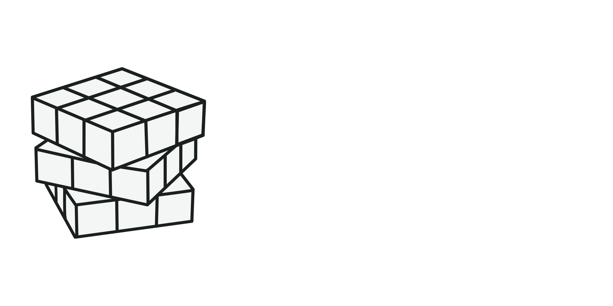

	
	
"A beautiful, hand-crafted and alternative portfolio."

---

     
    <a href="https://nilsschlegel.dev" target="_blank">🌐 Website</a>
     | 
    <a href="https://www.linkedin.com/in/nils-schlegel-470527382/" target="_blank">🤝 LinkedIn</a>
     | 
    <a href="https://github.com/nijasc" target="_blank">📦 GitHub</a>
     
     
    
    
    

# Table of contents

- [Philosophy](#philosophy)
- [Local development](#local-development)
- [Deploy for production](#deploy-for-production)
- [Architecture](#architecture)
- [Features](#features)
- [Libraries](#libraries)
- [Author](#author)
- [Contributing](#contributing)
- [License](#license)

# Philosophy

# Local development

# Deploy for production

# Architecture

# Features

# Libraries

# Author

# Contributing

# License
